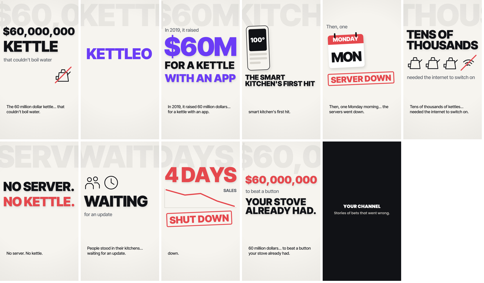
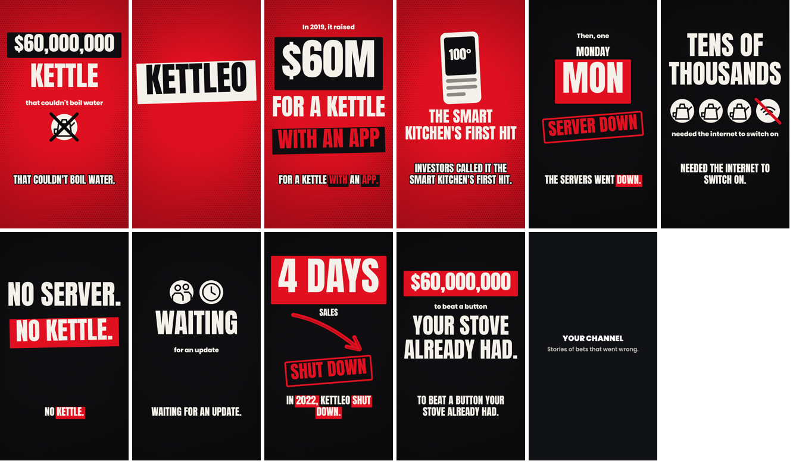

# Story Video Studio

A Claude skill that helps anyone make short documentary-style **story videos**, the "what happened to X" kind: rises, falls, scandals, comebacks and bets that went wrong. It works for 9:16 Shorts, Reels and TikTok, and for 16:9 YouTube.

**No video or tech experience needed.** Type `/video`, say what the story is, and Claude does the rest, stopping at four checkpoints for your OK:

**Script ✔ → Look ✔ → Sound ✔ → Post ✔**

You end up with a script and fact-check list, a scene-by-scene storyboard, a sound plan, thumbnail ideas, and titles, captions and hashtags for each platform. The script styles, looks and sound settings come from a real production run of finished story-shorts.

---

## Quick start

```
/video
```
Claude asks one thing, **"What's the story?"**, then picks a script style and a look that fit, and explains the pick in one line. You can also just say it in plain words:

> make a video about the airline that sold unlimited lifetime tickets

At each checkpoint, click **Approve**, or say what to change.

| Want to… | Type |
|---|---|
| Make a video the easy way | `/video` |
| Choose everything yourself | `/video custom` |
| Get story ideas | `/ideas` or `/ideas failed gadgets` |
| Make a whole series fast | `/batch-mode` (settings locked once; it stops only at each script) |
| See the styles | `/styles` |
| See where you are | `/state` |
| Save everything as a file | `/export` (Markdown or JSON) |

---

## What makes it easy and cheap to run

- **Four checkpoints, never skipped.** Nothing moves on without your OK, and silence never counts as a yes.
- **Clickable answers.** In Claude Code, questions come as buttons. Elsewhere, you answer with one number. You'll never get more than two questions at a time.
- **One status line.** Every reply ends with a single line, for example:
  `📍 Quick · Kettleo · 9:16 ~37s · S1 Irony · V3 Keynote · Your voice + music · Next: Script ✔`
- **No jargon in chat.** Technical sound and render settings go into the files Claude writes, not the conversation.
- **Uses few tokens.** `SKILL.md` is short. Claude opens a detail file only when that step starts, and only for the look you picked, never all five. Revisions show just the changed lines.

## Styles

| Script styles | Looks |
|---|---|
| **S1 Irony Label**: "The $400 machine that lost to a human hand." | **V1 Mascot Story**: flat cartoon on navy, a mascot host |
| **S2 Verdict Label**: "The truck that was a lie." | **V2 Bold Story**: red-and-black poster, stamps, marker arrows |
| **S3 Then-vs-Now**: "Instacart… but in 1999." | **V3 Keynote Type**: clean product-launch typography |
| **Custom** | **V4 Case File**: cork board, typed cards, red string |
| | **V5 Tiny World 3D**: toy-town diorama, tilt-shift |
| | **Reference** (match a video you like) / **Custom** |

Every script follows one proven shape: **hook → name → stakes → the twist → the big moment → the fall → an ironic last line**.

## Facts and fairness
- Every script comes with a **⚠ Check these facts** list. You confirm it before you record.
- Accusations stay "alleged" until the story's record says otherwise.
- No real logos, no fake documents, and no altered faces of real people.

## Your brand
Fill in [`templates/brand-kit.md`](templates/brand-kit.md) with your end card, voice and (optionally) your own **Defaults** for `/video`. Nothing about another creator's brand is built in.

---

## Installation

### Claude Code
**For all your projects:**
```bash
git clone https://github.com/harshpatel98/story-video-studio.git ~/.claude/skills/story-video-studio
```
**For one project only:**
```bash
git clone https://github.com/harshpatel98/story-video-studio.git .claude/skills/story-video-studio
```
Start a new session and type `/video`.

### Claude Web / Desktop (Projects)
1. Create a **Project** (for example, "Story Videos").
2. In **Project Knowledge**, upload `SKILL.md`, every file in `references/` (including `references/visuals/`), and your filled-in `templates/brand-kit.md`.
3. In the project's **custom instructions**, add:
   > Follow SKILL.md from Project Knowledge for every request. Only consult a references file when SKILL.md's reference map says to.
4. Start a chat in the project and type `/video`.

> If your plan supports uploading custom skills (Settings → Capabilities → Skills), you can zip the `story-video-studio` folder and upload it instead.

---

## Rendering the actual video (Claude Code)
The skill includes a **render engine** for the **V3 Keynote Type** and **V2 Bold Story** looks. Say "render it" at the end of a run. Claude writes one small `video.json` (your approved lines plus what appears on screen) and runs one command, with no animation code written per video:

| V3 Keynote Type | V2 Bold Story |
|---|---|
|  |  |

You get a 1080×1920, 60 fps MP4 at −14 LUFS with your end card. If you recorded your voice, captions are timed to it, the music's lift lands on the twist, and the voice stays louder than music and effects on every word. QC sheets and a report are included. A first draft takes about a minute on a desktop PC.

One-time setup (Claude runs `make_video.py check` and shows you exactly what's missing): Python, `pip install numpy scipy pillow playwright faster-whisper`, `python -m playwright install chromium`, and ffmpeg. See [`engine/README.md`](engine/README.md).

V1, V4 and V5 are still plan-only. Claude can describe them fully, but the engine doesn't render them yet.

## Folder structure
```
story-video-studio/
├── SKILL.md                  # short core: rules, commands, checkpoints, reference map
├── references/               # read only when a step needs it
│   ├── script.md             # story shape, script styles, fact-check list
│   ├── audio.md              # voice, music, mix targets, sound-effect cues
│   ├── packaging.md          # thumbnails, platform captions, export format
│   ├── build.md              # how Claude writes video.json and runs the engine
│   └── visuals/
│       ├── index.md          # one-line summary of each look
│       ├── rules.md          # rules every look follows + storyboard format
│       └── v1-mascot.md … v5-tiny-world.md
├── engine/                   # render engine: make_video.py, player + looks (JS), Python pipeline, fonts
├── templates/brand-kit.md    # your end card, voice and defaults
├── examples/
│   ├── sample-production.md  # a full worked run, discovery to export
│   └── kettleo/video.json    # a ready-to-render example project
├── README.md
└── LICENSE
```

## Customizing
- **Add a look:** create `references/visuals/v6-yourname.md` (copy an existing look as a starting point) and add a row to `references/visuals/index.md`.
- **Add a script style:** add a row to the styles table in `references/script.md`.

## License
MIT — see [LICENSE](LICENSE).
